<p align="center">
  
</p>

<p align="center">
  
  
  
  
  
</p>

<p align="center">
  
</p>


<a id="table-of-contents"></a>
<p align="center">
  
</p>

<ul>
  <li><a href="#how-a-block-is-built">🧭 How a Block Is Built</a></li>
  <li><a href="#how-to-use">🚀 How to Use</a></li>
  <li><a href="#building-a-block">🧱 Building a Block</a>
    <ul>
      <li><a href="#creating-a-block">Creating a block</a></li>
      <li><a href="#adding-content">Adding content</a></li>
      <li><a href="#text-markers">Text markers</a></li>
      <li><a href="#columns">Columns</a></li>
      <li><a href="#tables">Tables</a></li>
      <li><a href="#images">Images</a></li>
      <li><a href="#saving-the-result">Saving the result</a></li>
      <li><a href="#animations">Animations</a></li>
    </ul>
  </li>
  <li><a href="#customization">🛠️ Customization</a>
    <ul>
      <li><a href="#creating-your-own-theme">Creating your own theme</a></li>
      <li><a href="#constants-reference">Constants reference</a></li>
    </ul>
  </li>
  <li><a href="#themes">🎨 Themes</a>
    <ul>
      <li><a href="#1-dark-colors">1. Dark Colors</a></li>
      <li><a href="#2-light-colors-pastels">2. Light Colors (Pastels)</a></li>
      <li><a href="#3-seasons">3. Seasons</a></li>
      <li><a href="#4-drinks">4. Drinks</a></li>
      <li><a href="#5-countries--geography">5. Countries &amp; Geography</a></li>
      <li><a href="#6-aesthetics--culture">6. Aesthetics &amp; Culture</a></li>
      <li><a href="#7-classical-ui-dev-themes">7. Classical UI (Dev Themes)</a></li>
      <li><a href="#8-mythology--concepts">8. Mythology &amp; Concepts</a></li>
    </ul>
  </li>
  <li><a href="#troubleshooting">🩺 Troubleshooting</a></li>
</ul>


<a id="how-a-block-is-built"></a>
<p align="center">
  
</p>

<p align="right"><a href="#table-of-contents">⬆ back to top</a></p>


<a id="how-to-use"></a>
<p align="center">
  
</p>

<p align="center">
  
</p>

```bash
python --version
pip install git+https://github.com/JonatasCortes/svgblock.git

# or clone the repository and install it from the folder
git clone https://github.com/JonatasCortes/svgblock.git
cd svgblock
pip install .
```

<p align="center">
  
</p>

```python
from svgblock import Block

(
    Block(theme="neon", width=900, animation="slide-up")
    .title("Hello, I'm Bob")
    .text("I build **small tools** in **pure Python** and I love open source.")
    .subsection("What I am learning")
    .text("Right now I am studying **graph algorithms** and **computer vision**.")
    .save("assets/block.svg")
)
```

<p align="center">
  
</p>

```bash
python generate_blocks.py
```

<p align="center">
  
</p>

```html
<p align="center">
  
</p>
```

<p align="center">
  
</p>

```python
from svgblock import Block

Block(theme="dracula", animation="fade").title("About me").text("...").save("assets/about.svg")
Block(theme="nord", animation="pop").title("Projects").text("...").save("assets/projects.svg")
```

<p align="right"><a href="#table-of-contents">⬆ back to top</a></p>


<a id="building-a-block"></a>
<a id="creating-a-block"></a>
<p align="center">
  
</p>

```python
Block(theme="red", width=900, animation="fade")
```

<a id="adding-content"></a>
<p align="center">
  
</p>

```python
(
    Block(theme="coffee")
    .title("Projects")
    .text("A few things I built.", font_size=18)
    .subsection("HNSW Character Recognition")
    .text("Train and test your own model.")
    .divider()
    .table(["Project", "Stars"], [["HNSW", 120], ["Voronoi Stats", 85]])
    .image("assets/preview.png", width=300)
    .divider(0.5)
    .title("Contact")
    .text("Find me on GitHub.")
)
```

<a id="text-markers"></a>
<p align="center">
  
</p>

```python
.text("**ola __mundo__** ola, --errado-- e ##inclinado##")
.text(r"A literal \*\* needs a backslash before each asterisk.")
```

<a id="columns"></a>
<p align="center">
  
</p>

```python
from svgblock import Block, Column

(
    Block(theme="nord")
    .columns(
        Column(1).subsection("Weight 1").text("A narrow column, good for short notes."),
        Column(2).subsection("Weight 2").text("A column twice as wide, ideal for the main text."),
    )
)
```

<a id="tables"></a>
<p align="center">
  
</p>

```python
.table(
    ["Language", "Level", "Typed"],
    [
        ["Python", "**Advanced**", True],
        ["Rust", "##Learning##", True],
        ["COBOL", "--Retired--", None],
    ],
    align=("left", "center", "center"),
    weights=(2, 2, 1),
    striped=True,
    row_dividers=True,
    column_dividers=False,
)
```

<a id="images"></a>
<p align="center">
  
</p>

```python
(
    Block(theme="mocha")
    .columns(
        Column(1).image("assets/logo.png", width=110),
        Column(4).subsection("A logo beside the text").text("The text takes the rest of the width."),
    )
)
```

<a id="saving-the-result"></a>
<p align="center">
  
</p>

<a id="animations"></a>
<p align="center">
  
</p>

<p align="center">
  
  
  
  
  
  
</p>

```python
from svgblock import Animation, Block

# No animation (the default)
Block()

# Plays once
Block(animation="pop")
Block(animation=Animation.SLIDE_UP)

# Replays every 5 seconds
Block(animation="slide-up", animation_loop=5)
```

<p align="right"><a href="#table-of-contents">⬆ back to top</a></p>


<a id="customization"></a>
<p align="center">
  
</p>

<a id="creating-your-own-theme"></a>
<p align="center">
  
</p>

```python
"mytheme": {
    "background_center": "#1B2B34", "background_edge": "#0B1014",
    "border_start": "#6699CC", "border_end": "#223344",
    "title_text": "#99C794", "title_bar": "#99C794",
    "subsection_text": "#FAC863", "subsection_marker": "#FAC863",
    "text": "#D8DEE9", "highlight": "#FFFFFF",
    "underline": "#6699CC", "strikethrough": "#65737E", "italic": "#C0C5CE",
    "table_background": "#10181D", "table_header_background": "#223540",
    "table_header_text": "#99C794", "table_text": "#D8DEE9",
    "table_divider": "#33505F", "table_stripe_background": "#15222A",
    "table_border": "#33505F", "divider": "#6699CC",
},
```

<a id="constants-reference"></a>
<p align="center">
  
</p>

```bash
git clone https://github.com/JonatasCortes/svgblock.git
cd svgblock
pip install -e .
```

<p align="right"><a href="#table-of-contents">⬆ back to top</a></p>


<a id="themes"></a>
<p align="center">
  
</p>

<a id="1-dark-colors"></a>
<p align="center">
  
</p>
<p align="center">
  
  
  
  
  
  
  
  
</p>

<a id="2-light-colors-pastels"></a>
<p align="center">
  
</p>
<p align="center">
  
  
  
  
  
</p>

<a id="3-seasons"></a>
<p align="center">
  
</p>
<p align="center">
  
  
  
  
</p>

<a id="4-drinks"></a>
<p align="center">
  
</p>
<p align="center">
  
  
  
  
  
  
</p>

<a id="5-countries--geography"></a>
<p align="center">
  
</p>
<p align="center">
  
  
  
  
  
  
  
  
  
  
  
  
  
</p>

<a id="6-aesthetics--culture"></a>
<p align="center">
  
</p>
<p align="center">
  
  
  
  
  
</p>

<a id="7-classical-ui-dev-themes"></a>
<p align="center">
  
</p>
<p align="center">
  
  
  
  
  
  
</p>

<a id="8-mythology--concepts"></a>
<p align="center">
  
</p>
<p align="center">
  
  
  
</p>

<p align="right"><a href="#table-of-contents">⬆ back to top</a></p>


<a id="troubleshooting"></a>
<p align="center">
  
</p>

<p align="right"><a href="#table-of-contents">⬆ back to top</a></p>


<p align="center">
  
</p>