<p align="center">
  
</p>

<p align="center">
  
  
  
  
  
  
  
</p>

<p align="center">
  
</p>

<a id="table-of-contents"></a>

<p align="center">
  
</p>

<ul>
  <li><a href="#how-a-block-is-built">🧭 How a Block Is Built</a></li>
  <li><a href="#how-to-use">🚀 How to Use</a></li>
  <li><a href="#building-a-block">🧱 Building a Block</a>
    <ul>
      <li><a href="#creating-a-block">Creating a block</a></li>
      <li><a href="#adding-content">Adding content</a></li>
      <li><a href="#text-markers">Text markers</a></li>
      <li><a href="#columns">Columns</a></li>
      <li><a href="#tables">Tables</a></li>
      <li><a href="#images">Images</a></li>
      <li><a href="#saving-the-result">Saving the result</a></li>
    </ul>
  </li>
  <li><a href="#animations">🎞️ Animations</a>
    <ul>
      <li><a href="#base-animations">Base animations</a></li>
      <li><a href="#animation-parameters">Parameters</a></li>
      <li><a href="#easings">Easings</a></li>
      <li><a href="#repeating">Repeating</a></li>
      <li><a href="#sequences">Sequences</a></li>
      <li><a href="#animation-errors">Errors</a></li>
    </ul>
  </li>
  <li><a href="#customization">🛠️ Customization</a>
    <ul>
      <li><a href="#creating-your-own-theme">Creating your own theme</a></li>
      <li><a href="#editing-a-theme">Editing a theme</a></li>
      <li><a href="#constants-reference">Constants reference</a></li>
    </ul>
  </li>
  <li><a href="#themes">🎨 Themes</a>
    <ul>
      <li><a href="#1-dark-colors">1. Dark Colors</a></li>
      <li><a href="#2-light-colors-pastels">2. Light Colors (Pastels)</a></li>
      <li><a href="#3-seasons">3. Seasons</a></li>
      <li><a href="#4-drinks">4. Drinks</a></li>
      <li><a href="#5-countries--geography">5. Countries & Geography</a></li>
      <li><a href="#6-aesthetics--culture">6. Aesthetics & Culture</a></li>
      <li><a href="#7-classical-ui-dev-themes">7. Classical UI (Dev Themes)</a></li>
      <li><a href="#8-mythology--concepts">8. Mythology & Concepts</a></li>
    </ul>
  </li>
  <li><a href="#troubleshooting">🩺 Troubleshooting</a></li>
</ul>

<a id="how-a-block-is-built"></a>

<p align="center">
  
</p>

<p align="right"><a href="#table-of-contents">⬆ back to top</a></p>

<a id="how-to-use"></a>

<p align="center">
  
</p>

<p align="center">
  
</p>

```bash
pip install svgblock
```

<p align="center">
  
</p>

```python
rom svgblock import Block, Rise, Theme

(
    Block(theme=Theme.NEON, width=900, animation=Rise())
    .title("Hello, I'm Bob")
    .text("I build **small tools** in **pure Python** and I love open source.")
    .subsection("What I am learning")
    .text("Right now I am studying **graph algorithms** and **computer vision**.")
    .save("assets/block.svg")
)
```

<p align="center">
  
</p>

```bash
python generate_blocks.py
```

<p align="center">
  
</p>

```html

```

```markdown

```

<p align="center">
  
</p>

```python
from svgblock import Block, Fade, Pop, Theme

Block(theme=Theme.DRACULA, animation=Fade()).title("About me").text("...").save("assets/about.svg")
Block(theme=Theme.NORD, animation=Pop()).title("Projects").text("...").save("assets/projects.svg")
```

<p align="center">
  
</p>

```bash
git clone https://github.com/JonatasCortes/svgblock.git
cd svgblock
pip install -e .
```

<p align="right"><a href="#table-of-contents">⬆ back to top</a></p>

<a id="building-a-block"></a>
<a id="creating-a-block"></a>

<p align="center">
  
</p>

```python
from svgblock import Block, Fade, Theme

Block(theme=Theme.RED, width=900, padding=32, animation=Fade())
```

<a id="adding-content"></a>

<p align="center">
  
</p>

```python
(
    Block(theme=Theme.COFFEE)
    .title("Projects")
    .text("A few things I built.", font_size=18)
    .subsection("Log parser")
    .text("Reads log files and prints a short summary.")
    .divider()
    .table(["Project", "Stars"], [["logparse", 120], ["tinyserver", 85]])
    .image("assets/preview.png", width=300)
    .divider(0.5)
    .title("Contact")
    .text("Find me on GitHub.")
)
```

<a id="text-markers"></a>

<p align="center">
  
</p>

```python
.text("**bold**, __underlined__, --struck-- and ##italic##")
.text(r"A literal \*\* needs a backslash before each asterisk.")
```

<a id="columns"></a>

<p align="center">
  
</p>

```python
from svgblock import Block, Column, Theme

(
    Block(theme=Theme.NORD)
    .columns(
        Column(1).subsection("Weight 1").text("A narrow column."),
        Column(2).subsection("Weight 2").text("A column twice as wide."),
    )
)
```

<a id="tables"></a>

<p align="center">
  
</p>

```python
.table(
    ["Language", "Level", "Typed"],
    [
        ["Python", "**Advanced**", True],
        ["Rust", "##Learning##", True],
        ["COBOL", "--Retired--", None],
    ],
    align=("left", "center", "center"),
    weights=(2, 2, 1),
    striped=True,
    row_dividers=True,
    column_dividers=True,
)
```

<a id="images"></a>

<p align="center">
  
</p>

```python
(
    Block(theme=Theme.NEON)
    .columns(
        Column().image("assets/logo.png", width=350),
        Column().subsection("A logo beside the text").text("The image sits in a column and the text takes the rest of the width"),
    )
)
```

<a id="saving-the-result"></a>

<p align="center">
  
</p>

<p align="right"><a href="#table-of-contents">⬆ back to top</a></p>

<a id="animations"></a>

<p align="center">
  
</p>

```python
from svgblock import Block, Pop, Rise, Sequence, Show

# Default values
Block(animation=Rise())

# A configured animation
Block(animation=Rise(distance=80, duration=1.2))

# A sequence: enter, rest for 3 seconds and enter again, forever
Block(animation=Sequence(Pop(), Show(3), loop_limit=None))
```

<a id="base-animations"></a>

<p align="center">
  
</p>

<p align="center">
  
  
  
  
  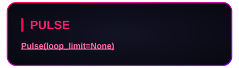
</p>

<a id="animation-parameters"></a>

<p align="center">
  
</p>

```python
from svgblock import Drop, Fade, Linear, Pop, Pulse, Rise

Rise(distance=80, duration=1.6, fade=False)
Drop(distance=20, duration=0.4)
Pop(start_scale=0.3, duration=1.2)
Pulse(amount=0.1, duration=1, loop_limit=4)
Fade(duration=2, easing=Linear())
```

<p align="center">
  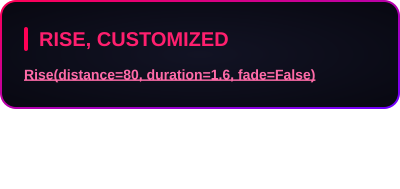
  
  
  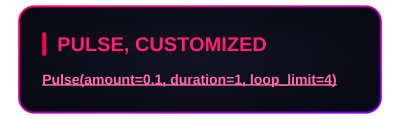
</p>

<a id="easings"></a>

<p align="center">
  
</p>

```python
from svgblock import CubicBezier, EaseInOut, Rise, Steps

Rise(easing=EaseInOut())
Rise(easing=CubicBezier(0.4, 0, 0.2, 1))
Rise(easing=Steps(10))
```

<p align="center">
  
  
  
</p>

<a id="repeating"></a>

<p align="center">
  
</p>

```python
from svgblock import Pulse

Pulse()                  # runs once
Pulse(loop_limit=4)      # runs five times
Pulse(loop_limit=None)   # never stops
```

<a id="sequences"></a>

<p align="center">
  
</p>

```python
from svgblock import Hide, Show, Pop, Pulse, Rise, Sequence

Sequence(Pop(), Show(3), loop_limit=None)

Sequence(Hide(0.5), Rise(), Pulse(loop_limit=1), Show(2), loop_limit=None)
```

<p align="center">
  
  
</p>

<a id="animation-errors"></a>

<p align="center">
  
</p>

```python
from svgblock import CubicBezier, Pulse, Rise, Sequence, Show

Rise(distance=-10)                 # ValueError: distance must be 0 or more
Rise(loop_limit=2)                 # TypeError: unexpected keyword argument 'loop_limit'
Rise(easing="ease-out")            # TypeError: easing must be an Easing, such as EaseOut() ...
CubicBezier(1.5, 0, 0.5, 1)        # ValueError: x1 must be between 0 and 1
Sequence(Rise, Pulse())            # TypeError: A sequence step must be an animation, such as Rise() ...

# ValueError: the Show after an infinite step would never play
Sequence(Pulse(loop_limit=None), Show(1))
```

<p align="right"><a href="#table-of-contents">⬆ back to top</a></p>

<a id="customization"></a>

<p align="center">
  
</p>

<a id="creating-your-own-theme"></a>

<p align="center">
  
</p>

```python
from svgblock import Block, ThemeData

ocean = ThemeData(
    background_center="#1B2B34", background_edge="#0B1014",
    border_start="#6699CC", border_end="#223344",
    title_text="#99C794", title_bar="#99C794",
    subsection_text="#FAC863", subsection_marker="#FAC863",
    text="#D8DEE9", highlight="#FFFFFF",
    underline="#6699CC", strikethrough="#65737E", italic="#C0C5CE",
    table_background="#10181D", table_header_background="#223540",
    table_header_text="#99C794", table_text="#D8DEE9",
    table_divider="#33505F", table_stripe_background="#15222A",
    table_border="#33505F", divider="#6699CC",
)

Block(theme=ocean).title("Ocean").text("A theme created in my own code.").save("assets/ocean.svg")
```

<a id="editing-a-theme"></a>

<p align="center">
  
</p>

```python
from svgblock import Block, Theme

# Changes the theme for the whole program: set it before building the blocks
Theme.RED.value.update(title_text="#FF9900", title_bar="#FF9900")
Block(theme=Theme.RED).title("Orange titles on the red theme")

# Makes a variation and keeps the original untouched
softer_red = Theme.RED.value.copy()
softer_red.update(background_center="#2A1414", text="#FFD9D9")
Block(theme=softer_red).title("A softer red")
```

<a id="constants-reference"></a>

<p align="center">
  
</p>

<p align="right"><a href="#table-of-contents">⬆ back to top</a></p>

<a id="themes"></a>

<p align="center">
  
</p>

```python
from svgblock import Block, Theme

Block(theme=Theme.DRACULA)

# List every ready-made theme
for theme in Theme:
    print(theme.name)
```

<a id="1-dark-colors"></a>

<p align="center">
  
</p>

<p align="center">
  
  
  
  
  
  
  
  
</p>

<a id="2-light-colors-pastels"></a>

<p align="center">
  
</p>

<p align="center">
  
  
  
  
  
</p>

<a id="3-seasons"></a>

<p align="center">
  
</p>

<p align="center">
  
  
  
  
</p>

<a id="4-drinks"></a>

<p align="center">
  
</p>

<p align="center">
  
  
  
  
  
  
</p>

<a id="5-countries--geography"></a>

<p align="center">
  
</p>

<p align="center">
  
  
  
  
  
  
  
  
  
  
  
  
  
</p>

<a id="6-aesthetics--culture"></a>

<p align="center">
  
</p>

<p align="center">
  
  
  
  
  
</p>

<a id="7-classical-ui-dev-themes"></a>

<p align="center">
  
</p>

<p align="center">
  
  
  
  
  
  
</p>

<a id="8-mythology--concepts"></a>

<p align="center">
  
</p>

<p align="center">
  
  
  
</p>

<p align="right"><a href="#table-of-contents">⬆ back to top</a></p>

<a id="troubleshooting"></a>

<p align="center">
  
</p>

<p align="right"><a href="#table-of-contents">⬆ back to top</a></p>

<p align="center">
  
</p>